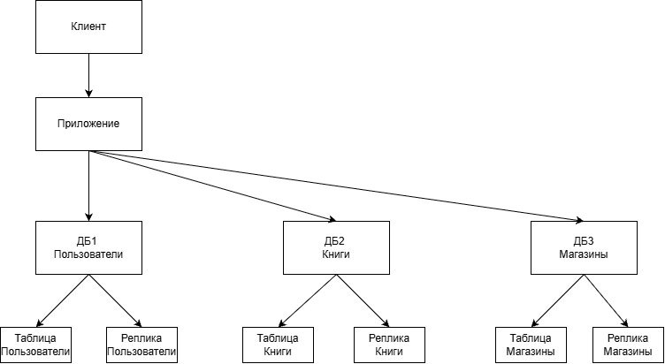
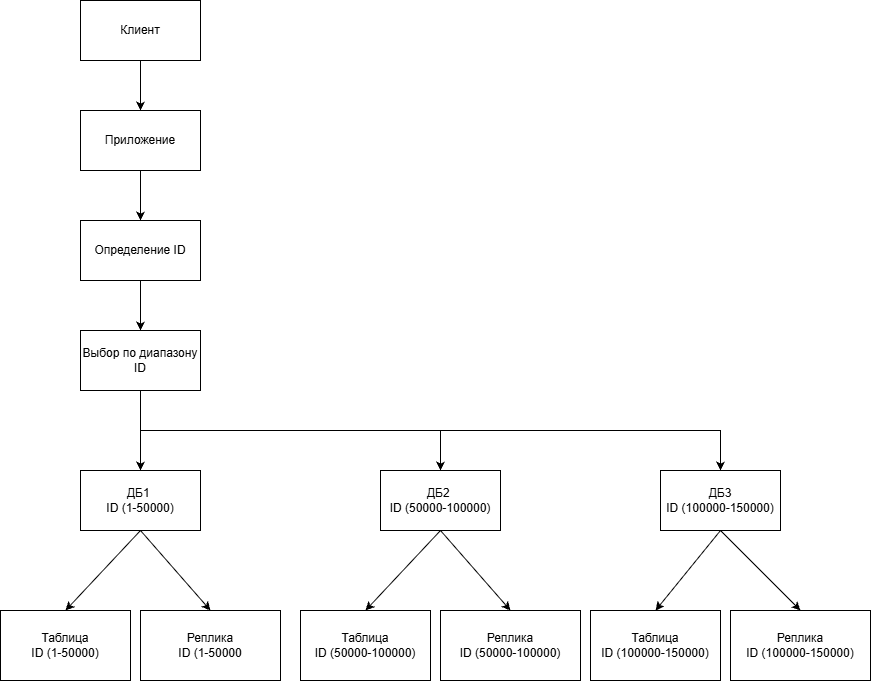
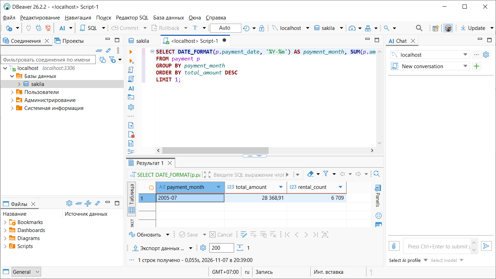

# Домашнее задание к занятию "`SQL. Часть 2`" - `Рудковский М.Д.`
---

### Задание 1
---
```SQL
SELECT s.first_name, s.last_name, ci.city, COUNT(c.customer_id) AS customer_count
FROM store st
JOIN staff s ON st.store_id = s.store_id
JOIN address a ON st.address_id = a.address_id
JOIN city ci ON a.city_id = ci.city_id
JOIN customer c ON st.store_id = c.store_id
GROUP BY st.store_id, s.staff_id, s.first_name, s.last_name, ci.city
HAVING COUNT(c.customer_id) > 300;
```
---

---
### Задание 2
---
```SQL
SELECT store_id, COUNT(customer_id) AS customer_count
FROM customer
GROUP BY store_id;
```
---

---
### Задание 3
---
```SQL
SELECT DATE_FORMAT(payment_date, '%Y-%m') AS payment_month, SUM(amount) AS total_amount, COUNT(*) AS rental_count
FROM payment
GROUP BY payment_month
ORDER BY total_amount DESC
LIMIT 1;
```
---

---
