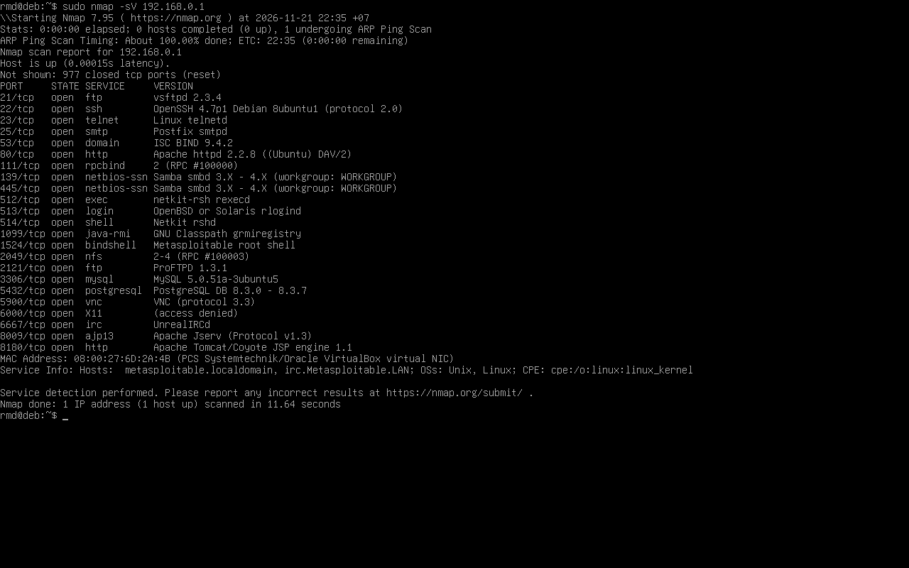

# Домашнее задание к занятию "`Репликация и масштабирование. Часть 2`" - `Рудковский М.Д.`
---

### Задание 1
---

  https://www.exploit-db.com/exploits/17491?utm_source
  https://www.exploit-db.com/exploits/16922?utm_source
  https://www.exploit-db.com/exploits/16320?utm_source
---
### Задание 2
---
Режим SYN Scan предполагает отправку TCP-пакетов с установленным флагом SYN. Если порт открыт сервер отвечает
пакетом SYN/ACK. Если порт закрыт, сервер отправляет RST. При этом полноценное TCP-соединение не устанавливается.
---
При FIN Scan отправляются TCP-пакеты с установленным флагом FIN. На закрытые порты сервер отвечает RST, а
на открытые порты, как правило, не отвечает.
---
При Xmas Scan отправляются TCP-пакеты с установленными флагами FIN, PSH и URG. Реакция сервера аналогична FIN
сканированию: закрытые порты отвечают RST, а открытые обычно не отправляют ответа.
---
UDP Scan отличается тем, что использует протокол UDP, не требующий предварительного установления соединения.
Если порт открыт, сервер может отправить UDP-ответ. Если порт закрыт, обычно возвращается ICMP-сообщение 
Destination Unreachable с кодом Port Unreachable. При отсутствии ответа порт определяется как открытый или 
фильтруемый.
---

